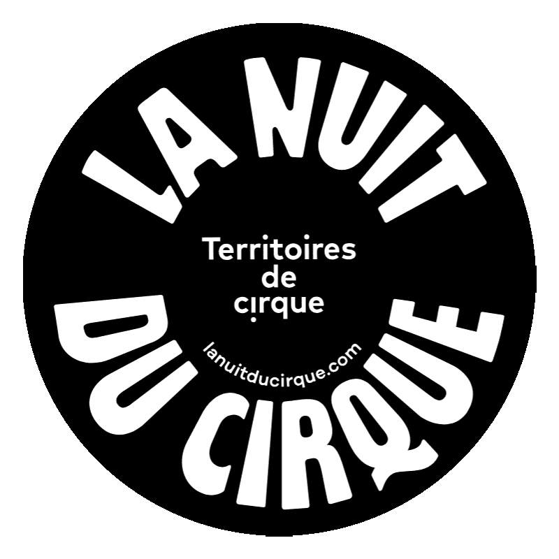
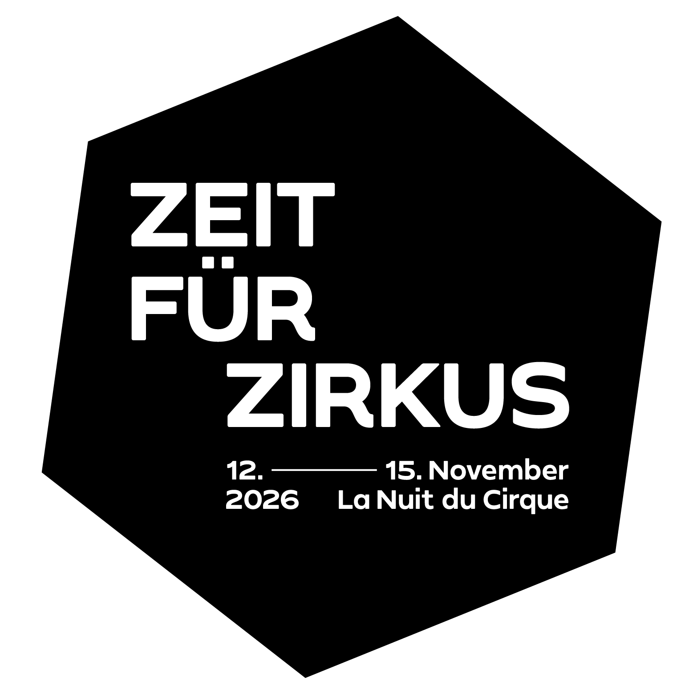

+++
startDate = 2026-11-14
#alternative = "Frühjahr 26"
title = """Zirkus färbt ab!"""
slug =  "2026/zirkus-faerbt-ab-pt2"
description = "Eine Show voller Akrobatik, Jonglage und Clownerie. Mit deiner Spende hilfst du uns, mehr Zirkus nach Franken zu bringen!"
summary = "Eine Show voller Akrobatik, Jonglage und Clownerie. Mit deiner Spende hilfst du uns, mehr Zirkus nach Franken zu bringen!"
tags = ["Show"]
showTableOfContents = false
+++

**Zirkus Quartier Franken e.V. und KinderJugendKultur Quibble präsentieren:**  

"Zirkus färbt ab!" - eine Showreihe voller Spaß, Artistik und guter Unterhaltung. Diese Show hinterlässt garantiert einen bleibenden Eindruck, bei euch und in der fränkischen Kulturlandschaft 

|||
|---|---|
|Datum|Sonntag 14. November 2026|
|Beginn|**18:00 Uhr** (Einlass: 17:30 Uhr)
|Ort|[](https://maps.app.goo.gl/vjqVtLmMPJ3i9Spj7) JugendKinderKultur Quibble Augustenstraße 25, 90461 Nürnberg|
|Preis|Eintritt frei|
|Spendenempfehlung| 10-15€ (Kinder: 5-10€)|
|Kontakt|info@zirkus-quartier-franken.de|

Lachen färbt ab, Staunen färbt ab, Konfetti färbt ab? – Zirkus färbt ab! Mit einem bunten Mix aus Artistik, Überraschungen und jeder Menge Kreativität verwandeln wir das KinderJugendKultur Quibble in ein Zirkusvarieté.

Lokale und überregionale Künstler*innen bringen ihre vielfältigen Talente, Tricks und Ideen auf die Bühne. Sie lassen die Schwerkraft kurz wackeln, überraschen mit außergewöhnlichen Darbietungen und bringen frischen Wind in die fränkische Kulturlandschaft. Es wird gestaunt, gelacht und mitgefiebert – und vielleicht sieht die Welt danach ein kleines bisschen anders aus.



Mit den Spenden, die wir an diesem Abend sammeln, holen wir besondere Zirkusshows nach Franken. So möchten wir die Region mit neuen kulturellen Highlights bereichern und unvergessliche Erlebnisse für Groß und Klein ermöglichen.


Wir freuen uns auf euch und auf einen Abend voller guter Laune, überraschender Momente und zeitgenössischer Zirkuskunst. Danke, dass ihr dabei seid und die Zirkuskultur in Franken unterstützt!

Diese Veranstaltung ist Teil des ZEIT FÜR ZIRKUS Festival, koordiniert vom
Bundesverband Zeitgenössischer Zirkus e.V. (BUZZ) und Teil der internationalen La
Nuit du Cirque, organisiert durch das Netzwerk Territoires de Cirque (Frankreich)


  
  
  

